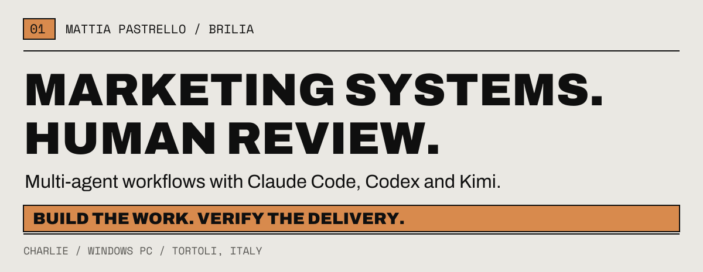
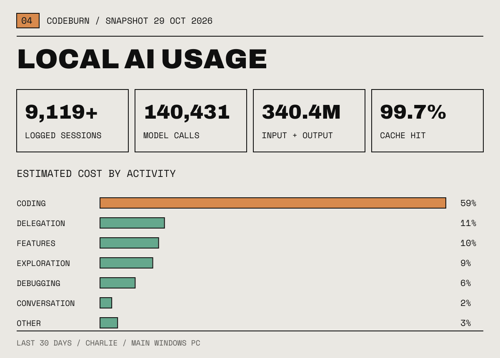
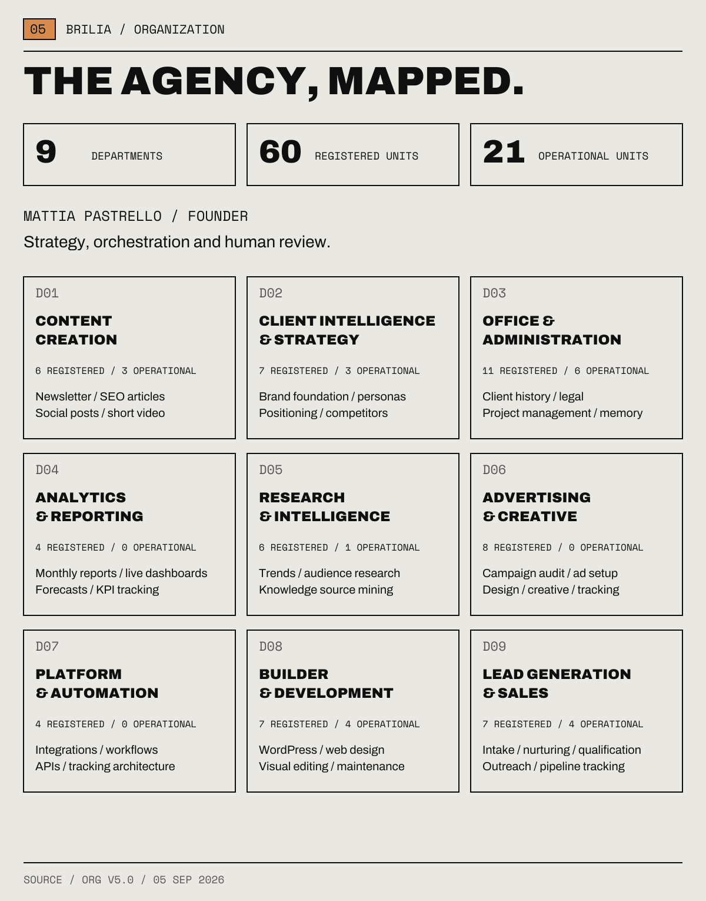
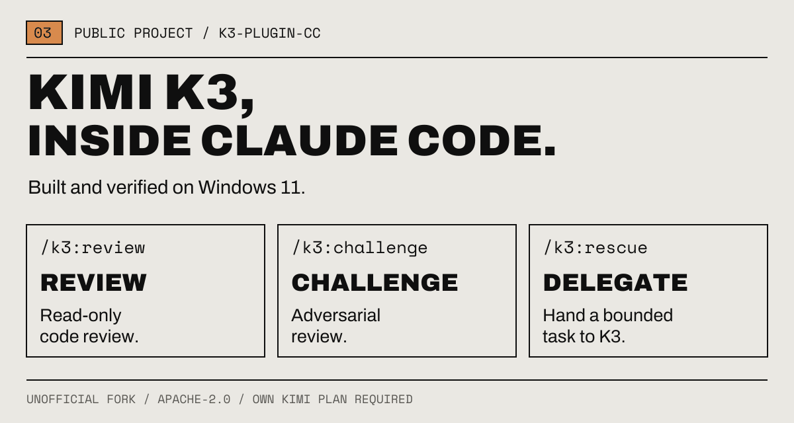
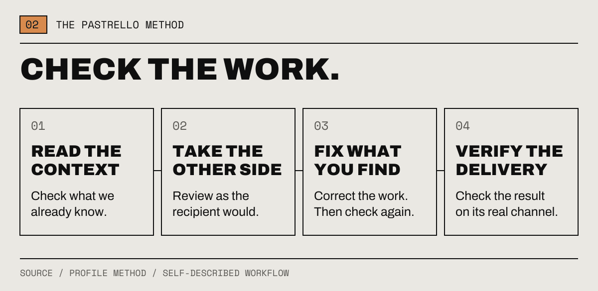

<!--
  Mattia Pastrello - founder of BRILIA, AI marketing operations
  GitHub: https://github.com/Mattiapastr
  Organization: https://github.com/Brilia-it
  Website: https://brilia.it
  Focus: multi-agent marketing systems on Claude Code, verified client delivery, Windows-first tooling for Claude Code
-->

<div align="center">

  <a href="https://brilia.it">
    <picture>
  <source media="(max-width: 600px) and (prefers-color-scheme: dark)" srcset="./assets/brilia22/header-dark-mobile.png" />
  <source media="(max-width: 600px)" srcset="./assets/brilia22/header-light-mobile.png" />
  <source media="(prefers-color-scheme: dark)" srcset="./assets/brilia22/header-dark.png" />
  
</picture>
  </a>


</div>

---

## About me

I run [BRILIA](https://brilia.it), a marketing agency in Italy. Its promise fits in one line: we bring clients to our clients.

I build multi-agent marketing workflows with Claude Code, Codex and Kimi. My work combines marketing strategy, software, automation and human review, with a focus on work that can be checked before delivery.

I build from the terminal and verify the result where people will use it. The rule I care about most: nothing is called delivered until someone has checked it on the channel it was delivered to.

**You will find something useful here if** you run client work with Claude Code or Codex and want the output checked before it leaves: a source for every number, quotes that match the transcript, links that open.

**Probably not, if** you are looking for a no-code template or a prompt pack.

---

## Local AI usage

<picture>
  <source media="(max-width: 600px) and (prefers-color-scheme: dark)" srcset="./assets/brilia22/stats-dark-mobile.png" />
  <source media="(max-width: 600px)" srcset="./assets/brilia22/stats-light-mobile.png" />
  <source media="(prefers-color-scheme: dark)" srcset="./assets/brilia22/stats-dark.png" />
  
</picture>

<sub>Measured with <a href="https://github.com/getagentseal/codeburn">CodeBurn</a> on Charlie, my main Windows PC. Rolling “Last 30 Days” view, captured on 29 October 2026. Session count is a lower bound and includes automated observer sessions. Input/output tokens exclude cache reads and writes: CodeBurn reports those separately as 36.50B read and 1.29B written. The activity bar shows estimated cost share, not turn share. Tools detected: Claude, Codex, Kimi Code and Copilot.</sub>

These usage figures describe workload on one PC; they are not a measure of output quality or client results.


---

## BRILIA organization

<picture>
  <source media="(max-width: 600px) and (prefers-color-scheme: dark)" srcset="./assets/brilia22/organization-dark-mobile.png" />
  <source media="(max-width: 600px)" srcset="./assets/brilia22/organization-light-mobile.png" />
  <source media="(prefers-color-scheme: dark)" srcset="./assets/brilia22/organization-dark.png" />
  
</picture>

The agency is organized into **9 departments and 60 registered units**. The v5.0 snapshot records **21 operational units** and **5 under construction**. These figures describe the structure documented on **5 September 2026**.

[Explore all 60 units and their recorded status](./docs/brilia-organization.md).

---

## Public project

<picture>
  <source media="(max-width: 600px) and (prefers-color-scheme: dark)" srcset="./assets/brilia22/k3-dark-mobile.png" />
  <source media="(max-width: 600px)" srcset="./assets/brilia22/k3-light-mobile.png" />
  <source media="(prefers-color-scheme: dark)" srcset="./assets/brilia22/k3-dark.png" />
  
</picture>

<div align="center">

| Project | What it does | License |
|:--------|:-------------|:-------:|
| **[k3-plugin-cc](https://github.com/Brilia-it/k3-plugin-cc)** | Drives Kimi K3 from Claude Code for reviews, adversarial challenges and delegated tasks. A fork of [linxule/kimi-plugin-cc](https://github.com/linxule/kimi-plugin-cc) that fixes the three things that break on Windows. | Apache-2.0 |

</div>

---

## Quickstart

Use Kimi K3 from inside Claude Code for reviews and delegated tasks, Windows included:

```text
# Add the marketplace, then install
/plugin marketplace add Brilia-it/k3-plugin-cc
/plugin install k3@brilia-k3-marketplace

# Then
/k3:review        # read-only review
/k3:challenge     # adversarial review
/k3:rescue        # hand a task to K3
```

You need your own Kimi Code subscription. The plugin never carries a credential.

---


## How I work

Four rules I work by. I call them the Pastrello Method.

<picture>
  <source media="(max-width: 600px) and (prefers-color-scheme: dark)" srcset="./assets/brilia22/method-dark-mobile.png" />
  <source media="(max-width: 600px)" srcset="./assets/brilia22/method-light-mobile.png" />
  <source media="(prefers-color-scheme: dark)" srcset="./assets/brilia22/method-dark.png" />
  
</picture>

- Before doing anything, check what we already know.
- Read the work again from the side of whoever receives it.
- What that second read finds, you fix. You don't just flag it.
- "Delivered" is proven on the channel, never assumed from "produced".

---


---

## Stack

### AI & agents
<p align="left">
  
  
  
  
  
  
</p>

### Marketing
<p align="left">
  
  
  
  
  
  
</p>

### Build
<p align="left">
  
  
  
  
  
</p>

---

## Connect

<p align="center">
  <a href="https://brilia.it"></a>
  <a href="https://github.com/Brilia-it"></a>
  <a href="https://www.linkedin.com/in/mattiapastrello/"></a>
  <a href="https://orcid.org/0009-0003-6709-3723"></a>
</p>
