<!--
  Mattia Pastrello - founder of BRILIA, AI marketing operations
  GitHub: https://github.com/Mattiapastr
  Organization: https://github.com/Brilia-it
  Website: https://brilia.it
  Focus: multi-agent marketing systems on Claude Code, verified client delivery, Windows-first tooling for Claude Code
-->

<div align="center">

  <a href="https://brilia.it">
    <picture>
      <source media="(prefers-color-scheme: dark)" srcset="./assets/header-dark.svg" />
      <source media="(prefers-color-scheme: light)" srcset="./assets/header-light.svg" />
      
    </picture>
  </a>

</div>

<p align="center">
  
  
</p>

---

## About me

I run [BRILIA](https://brilia.it), a marketing agency in Italy. Its promise fits in one line: we bring clients to our clients.

Behind it there is a system I built and keep building on Claude Code: a multi-agent setup organised like a real agency, in 9 divisions. Every department is built to one standard: a spec, a project-manager agent, one dispatch file per worker, and 16 checks to pass before it is called complete. 21 departments are live today. 6 more are being built.

I work from the terminal, not the browser. The rule I care about most: nothing is called delivered until someone has checked it on the channel it was delivered to.

<picture>
  <source media="(prefers-color-scheme: dark)" srcset="./assets/stats-dark.svg" />
  <source media="(prefers-color-scheme: light)" srcset="./assets/stats-light.svg" />
  
</picture>

<sub>Measured with <a href="https://github.com/getagentseal/codeburn">CodeBurn</a> on my main machine, 10 September to 9 October 2026.</sub>

**You will find something useful here if** you run client work with Claude Code or Codex and want the output checked before it leaves: a source for every number, quotes that match the transcript, links that open.

**Probably not, if** you are looking for a no-code template or a prompt pack.

---

## Quickstart

Use Kimi K3 from inside Claude Code for reviews and delegated tasks, Windows included:

```text
# Add the marketplace, then install
/plugin marketplace add Brilia-it/k3-plugin-cc
/plugin install k3@brilia-k3-marketplace

# Then
/k3:review        # read-only review
/k3:challenge     # adversarial review
/k3:rescue        # hand a task to K3
```

You need your own Kimi Code subscription. The plugin never carries a credential.

---

## In public

<div align="center">

| Project | What it does | License |
|:--------|:-------------|:-------:|
| **[k3-plugin-cc](https://github.com/Brilia-it/k3-plugin-cc)** | Drives Kimi K3 from Claude Code for reviews, adversarial challenges and delegated tasks. A fork of [linxule/kimi-plugin-cc](https://github.com/linxule/kimi-plugin-cc) that fixes the three things that break on Windows. | Apache-2.0 |

</div>

---

## How I work

Four of the 50 rules I work by. I call them the Pastrello Method.

- Before doing anything, check what we already know.
- Read the work again from the side of whoever receives it.
- What that second read finds, you fix. You don't just flag it.
- "Delivered" is proven on the channel, never assumed from "produced".

---

## Stack

### AI & agents
<p align="left">
  
  
  
  
  
  
</p>

### Marketing
<p align="left">
  
  
  
  
  
  
</p>

### Build
<p align="left">
  
  
  
  
  
</p>

---

## Connect

<p align="center">
  <a href="https://brilia.it"></a>
  <a href="https://github.com/Brilia-it"></a>
</p>
